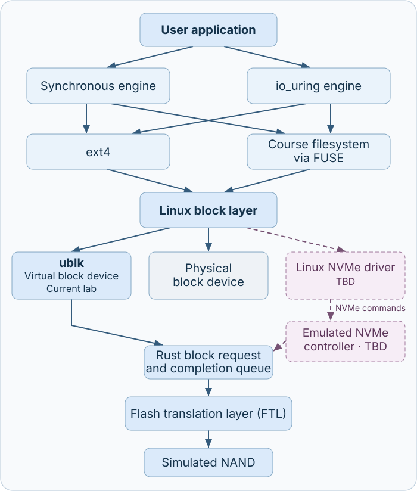

# I/O Journey

I/O Journey is a hands-on Rust course about what happens when an application
writes a file. Build a small storage stack, connect it to Linux, and see which
writes survive a simulated power cut.

**[Start the course](https://skyzh.github.io/io-journey/00-architecture.html)** · **[Browse the chapters](https://skyzh.github.io/io-journey/00-architecture.html#what-you-build)**

## 🚧 Work in Progress

Chapters, starter code, and commands may change. This course was written with
LLMs and has yet to receive Chi's full review.

## What you’ll build

The Linux append lab runs both I/O engines on both filesystems through ublk.
The block queue lab uses mixed random reads and writes.
The diagram also shows where physical storage and the planned NVMe lab fit.

- [NAND to SSD](course/01-ftl.md) — Implement NAND page operations, then make flash behave like a disk
  and test overwrite, collection, and recovery.
- [Blocks in flight](course/02-queue.md) — Build a block queue and see how it
  handles competing requests.
  [Host block scheduling](course/02a-scheduler.md) compares pass-through
  and bounded read-first dispatch ahead of the device queue.
- [Blocks to files](course/03-filesystem.md) — Build a small filesystem and
  see what it recovers after a crash.
- [Efficient application I/O](course/04-append.md) — Build an append log and
  compare two ways of writing to Linux filesystems.

Sponsored by [Raft.build](https://skyzh.github.io/io-journey/sponsor.html).

## License

The source code is licensed under [Apache 2.0](LICENSE).
The book text is © 2026 Alex Chi Z and is licensed under
[CC BY-NC-SA 4.0](https://creativecommons.org/licenses/by-nc-sa/4.0/).
