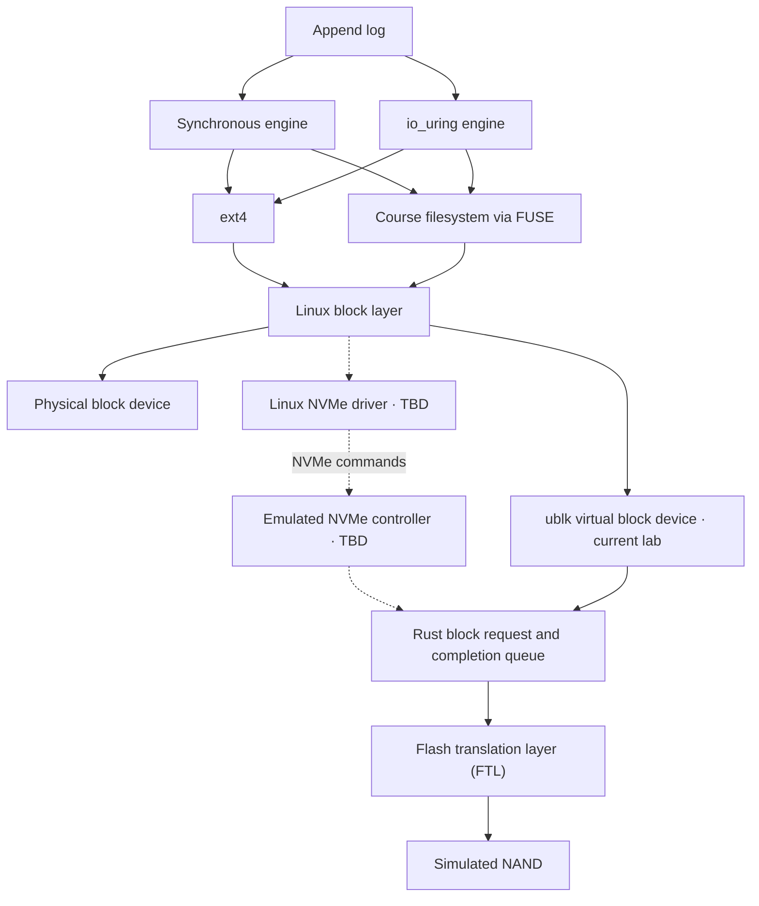

# I/O Journey

I/O Journey is a hands-on Rust course about what happens when an application
writes a file. Build a small storage stack, connect it to Linux, and see which
writes survive a simulated power cut.

**[Start the course](https://skyzh.github.io/io-journey/START.html)** · **[Browse the chapters](https://skyzh.github.io/io-journey/00-architecture.html#what-you-build)**

## 🚧 Work in Progress

Chapters, starter code, and commands may change. This course was written with
LLMs and has yet to receive Chi's full review.

## What you’ll build

The Linux append lab runs both I/O engines on both filesystems through ublk.
The diagram also shows where physical storage and the planned NVMe lab fit.

- [NAND to SSD](course/01-ftl.md) — Build the layer that makes flash behave
  like a disk, then use it under Linux with ext4.
- [Blocks in flight](course/02-queue.md) — Build a block queue and see how it
  handles competing requests.
- [Blocks to files](course/03-filesystem.md) — Build a small filesystem and
  see what it recovers after a crash.
- [Efficient application I/O](course/04-append.md) — Build an append log and
  compare two ways of writing to Linux filesystems.

Sponsored by [Raft.build](https://skyzh.github.io/io-journey/sponsor.html).
