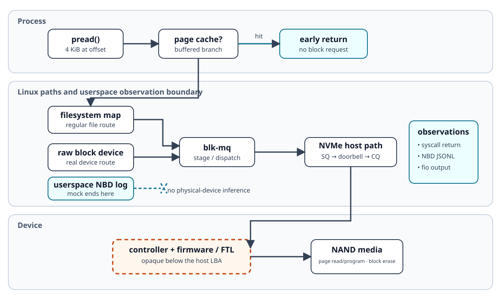
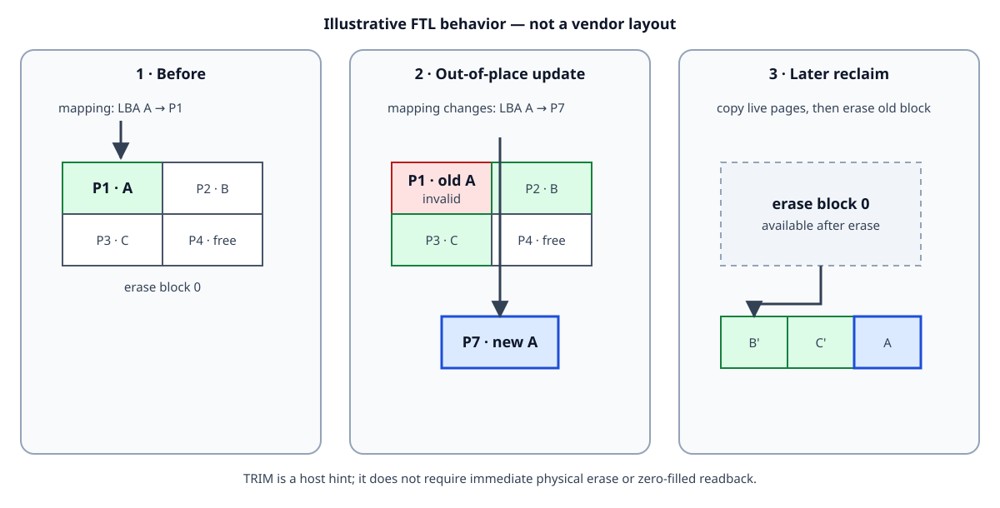

# From `read(2)` to NAND

A process asks for 4 KiB at a file offset. Did an SSD read a NAND page?

Not necessarily. The request may finish from memory, split into several block requests, wait in a queue, or reach a controller without reaching NAND at all. This chapter follows one device-reaching branch while marking every place where reality can diverge.

The companion lab gives us one honest observation point: a tiny userspace block server that logs the requests it receives. It cannot see through an SSD controller, so the boundary between what we observed and what we inferred stays visible throughout.



## Begin at the application contract

Suppose a process asks for 4 KiB with `pread(fd, buffer, 4096, offset)`. `pread()` reads at an explicit offset without changing the file descriptor's shared position, and a successful call may still return fewer bytes than requested. That is the application-visible contract; it says nothing about which lower layer supplied the bytes. See Linux [`pread(2)`](https://man7.org/linux/man-pages/man2/pread.2.html).

For a buffered regular file, Linux may satisfy the request from the page cache. No block request is required on that warm-cache path. Direct I/O provides a useful contrasting branch: where the filesystem supports it and alignment rules are met, `O_DIRECT` minimizes page-cache effects. Those rules vary by filesystem and kernel, and `O_DIRECT` is separate from synchronous durability flags; Linux documents both caveats in [`open(2)`](https://man7.org/linux/man-pages/man2/open.2.html) and its [iomap direct-I/O model](https://docs.kernel.org/filesystems/iomap/operations.html).

This distinction is the first important habit:

> A syscall is an observation at one boundary, not proof that every lower boundary was crossed.

## Map file bytes—or start at a block range

A regular-file request goes through a filesystem, which maps file offsets to storage blocks. A request sent directly to a block device starts below that filesystem mapping. The two routes can converge at Linux's block layer, but they are not equivalent: the filesystem owns metadata, allocation, and its own durability contract.

Linux `blk-mq` represents block work with software staging queues and driver-facing hardware dispatch queues. A request may be merged, scheduled, or sent directly; tags track outstanding work, and completion order is not guaranteed. The kernel's [`blk-mq` documentation](https://docs.kernel.org/block/blk-mq.html) describes those queues and the boundary between the generic block layer and a device driver.

Our NBD lab deliberately exposes the simpler raw-block side of this fork. The client connects to a private Unix socket instead of attaching `/dev/nbdX`, and the server logs the transmission request. That proves the NBD request reached this process. It does not prove that a filesystem, kernel block queue, physical controller, or NAND participated.

## From a host queue to a controller

For a physical NVMe-over-PCIe example, host software places a command into a memory-resident Submission Queue and updates the queue's tail doorbell. The controller fetches commands, transfers data using DMA-described buffers, posts a Completion Queue entry, and updates completion state; the host may use interrupts or polling. The exact rules live in the ratified [NVMe Base specification](https://nvmexpress.org/specification/nvm-express-base-specification/) and [NVMe over PCIe transport specification](https://nvmexpress.org/wp-content/uploads/NVM-Express-PCIe-Transport-Specification-1.0d-2023.12.27-Ratified.pdf).

The controller receives logical block addresses, not a physical NAND page number. Firmware commonly includes a flash translation layer (FTL) that maps logical addresses to physical locations and participates in allocation, garbage collection, wear management, and error handling. That is an opacity boundary: a host trace can show a submitted LBA, but usually cannot tell whether controller DRAM, flash media, background work, or a vendor-specific policy satisfied it.

At the media boundary, NAND exposes page-oriented read/program operations and block-oriented erase operations. It is inaccurate to summarize all NAND as “sequential append only.” A common update pattern programs a different free page, changes the logical mapping, leaves the old page invalid, and reclaims the containing erase block later. The exact geometry and constraints are device-specific; one concrete vendor datasheet illustrates separate [page program and block erase operations](https://europe.kioxia.com/content/dam/kioxia/newidr/productinfo/datasheet/201910/DST_TH58NYG3S0HBAI4-TDE_EN_31565.pdf).



This picture is illustrative FTL behavior, not a vendor layout. TRIM does not point to a particular panel or force immediate erase.

## Four operations we can observe

Build the lab and run its local probe from the repository root:

```console
cargo build --release
./target/release/rust-nbd-lab verify /tmp/io-journey-check-1
```

The server exposes exactly 1 MiB from a newly created regular file and appends one deterministic JSON object per operation. A successful run records:

```json
{"seq":1,"op":"write","offset":0,"length":4096,"status":"ok"}
{"seq":2,"op":"flush","offset":0,"length":0,"status":"ok"}
{"seq":3,"op":"read","offset":0,"length":4096,"status":"ok"}
{"seq":4,"op":"trim","offset":0,"length":4096,"status":"ok"}
{"seq":5,"op":"flush","offset":0,"length":0,"status":"ok"}
{"seq":6,"op":"read","offset":0,"length":4096,"status":"ok"}
{"seq":7,"op":"disconnect","offset":0,"length":0,"status":"ok"}
```

Each command has a deliberately narrow meaning:

- **READ** asks the server for a byte range. A successful reply contains those bytes.
- **WRITE** changes the regular backing file. An ordinary successful WRITE reply does not, by itself, promise non-volatile persistence.
- **FLUSH** calls `sync_all` before the lab sends success. This is the server's declared backing-file boundary, not the whole POSIX `fsync()` contract. Linux documents the file-data and metadata scope of [`fsync(2)`](https://man7.org/linux/man-pages/man2/fsync.2.html), while block devices separately expose flush/FUA ordering mechanisms described by the kernel's [writeback-cache control documentation](https://docs.kernel.org/block/writeback_cache_control.html).
- **TRIM** is a discard hint. This lab zeroes the requested range so repeated local traces have deterministic readback; the [NBD protocol](https://github.com/NetworkBlockDevice/nbd/blob/d42fabaecc56c938343e16995bd781b2c8b29bb0/doc/proto.md) does not let a client assume zeroes after a generic trim.

Repeat the probe into a second new directory and compare the logs:

```console
./target/release/rust-nbd-lab verify /tmp/io-journey-check-2
cmp /tmp/io-journey-check-1/events.jsonl \
    /tmp/io-journey-check-2/events.jsonl
```

Matching logs establish deterministic protocol behavior for this bounded client and server. They do not establish hardware latency, crash durability, or Linux libnbd interoperability.

## Drive the same boundary with `fio`

On Linux, fio 3.42's libnbd-backed engine can connect directly to the private Unix socket. The runner refuses existing output paths, creates a mode-0700 temporary root, starts one captured server PID, accepts only `read`, `write`, `flush`, or `trim`, and cleans up that PID, socket, image, and log on normal exit or a signal. It never attaches a kernel NBD device.

First confirm that the installed build contains the engine:

```console
fio --enghelp=nbd
```

Then run one finite experiment:

```console
./run-fio.sh ./target/release/rust-nbd-lab read evidence/read-a
```

The four supplied jobs use 4 KiB requests, one thread, requested depth 1, and a bounded 4 KiB or 16 KiB range. They are observation exercises, not a benchmark of NAND or NVMe. fio's [HOWTO](https://github.com/axboe/fio/blob/ab77643023f5d7e3c1b71a7576a564f368bf577a/HOWTO.rst) is the source of truth for engine, depth, direct-I/O, sync, trim, and latency-output options.

For each result, record the target, access pattern, request size, range, I/O engine, direct/buffered mode, requested and achieved depth, job count, runtime, and latency sample. `iodepth` is requested outstanding work, not proof of device queue depth. P99 describes this sample under this configuration; it is not a stability score. More outstanding I/O can expose parallelism, add queueing delay, or do both.

The local macOS development host does not currently provide fio/libnbd or a Linux runner. The built-in Rust probe therefore validates the protocol slice locally, while the supplied fio lane remains an explicit independent Linux acceptance gate.

## Related paths, kept separate

`io_uring` changes how applications submit operations and receive completions; it does not erase the filesystem, block, driver, or device layers used by an operation. SPDK can move an NVMe path into userspace with polling and DMA, but copies, notifications, translations, and storage access depend on the configuration. Those are later I/O Journey units, not shortcuts in this request path.

Mini-LSM will eventually connect host writes, flushes, and compactions to the block-I/O workload they produce. LSM compaction and SSD garbage collection are different mechanisms at different layers. Stateful System Lessons examines acknowledgement and durability boundaries; this NBD mock does not become crash-safe storage merely because it implements FLUSH.

The pilot ends at a useful, honest boundary: we can observe the request that reaches our block server, state what the server does before replying, and name everything below it that remains opaque.
